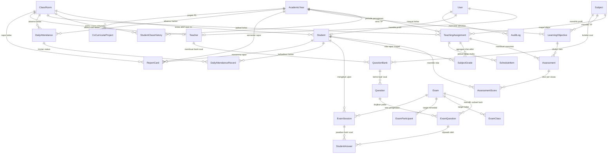

# DATABASE DESIGN & DATA DICTIONARY (DATABASE_DESIGN.md)
## PLATFORM SISTEM INFORMASI AKADEMIK, CBT & E-RAPOR SEKOLAH TERPADU
**Versi:** 1.0.0  
**Target Engine:** SQLite (WAL Mode) / PostgreSQL Compatible (Prisma ORM)  
**Status:** Definitif & Disahkan  

---

## 1. ENTITY RELATIONSHIP OVERVIEW (ERD)

Diagram di bawah menggambarkan hubungan antar entitas utama yang menyatukan autentikasi, master data akademik, kurikulum berbasis Tujuan Pembelajaran (TP), mesin ujian CBT, absensi terpisah, dan rapor:

---

## 2. KAMUS DATA LENGKAP (DATA DICTIONARY)

Berikut adalah spesifikasi mendalam untuk seluruh 34 tabel entitas sistem:

### 2.1 Domain Pengguna & Autentikasi

#### Tabel: `User`
Menyimpan kredensial identitas pengguna seluruh peran sistem dengan *Zero-Plaintext Invariant*.
| Kolom | Tipe Data | Nullable | Default | Keterangan & Aturan Integritas |
|---|---|---|---|---|
| `id` | String (UUID) | No | `uuid()` | Primary Key unik. |
| `username` | String | No | - | Unique. Berisi NISN (Siswa), NIP (Guru), atau username (Admin). |
| `password` | String | No | - | Hash password bcrypt (Cost 10). Dilarang simpan plaintext. |
| `mustChangePassword` | Boolean | No | `true` | Mencegat akses login awal agar wajib ubah password pribadi. |
| `role` | Enum `Role` | No | `SISWA` | `SUPER_ADMIN`, `ADMIN_TU`, `KEPALA_SEKOLAH`, `GURU`, `SISWA`. |
| `name` | String | No | - | Nama lengkap resmi pengguna. |
| `email` | String | Yes | `NULL` | Alamat surel (opsional). |
| `avatar` | String | Yes | `NULL` | Path foto profil pengguna. |
| `isActive` | Boolean | No | `true` | Status aktif akun (false = akun dinonaktifkan). |
| `createdAt` | DateTime | No | `now()` | Waktu pembuatan akun. |
| `updatedAt` | DateTime | No | - | Timestamp perubahan akun terakhir. |

---

### 2.2 Domain Master Data Akademik

#### Tabel: `AcademicYear`
Menyimpan siklus tahun ajaran dan semester aktif sekolah.
| Kolom | Tipe Data | Nullable | Default | Keterangan & Aturan Integritas |
|---|---|---|---|---|
| `id` | String (UUID) | No | `uuid()` | Primary Key. |
| `name` | String | No | - | Format: "2026/2027". |
| `semester` | Integer | No | - | `1` (Semester Ganjil) atau `2` (Semester Genap). |
| `reportDate` | DateTime | Yes | `NULL` | Titimangsa resmi cetak rapor dari Dinas Pendidikan. |
| `isActive` | Boolean | No | `false` | Menandai tahun ajaran berjalan. Hanya 1 yang bernilai true. |
| `startDate` | DateTime | No | - | Tanggal awal kalender pendidikan. |
| `endDate` | DateTime | No | - | Tanggal akhir semester. |
*Index Unik*: `@@unique([name, semester])`.

#### Tabel: `ClassRoom`
Data rombongan belajar (rombel) di sekolah.
| Kolom | Tipe Data | Nullable | Default | Keterangan & Aturan Integritas |
|---|---|---|---|---|
| `id` | String (UUID) | No | `uuid()` | Primary Key. |
| `name` | String | No | - | Nama kelas resmi, contoh: "X-MIPA-1", "XII-IPS-2". |
| `grade` | Integer | No | - | Tingkat kelas: `10`, `11`, atau `12`. |
| `isArchived` | Boolean | No | `false` | Soft-delete flag (tidak menghapus riwayat nilai). |
| `homeroomTeacherId` | String (UUID) | Yes | `NULL` | Foreign Key ke `Teacher.id` (Relasi 1-to-1 Wali Kelas). |

#### Tabel: `Subject`
Daftar mata pelajaran kurikulum sekolah.
| Kolom | Tipe Data | Nullable | Default | Keterangan & Aturan Integritas |
|---|---|---|---|---|
| `id` | String (UUID) | No | `uuid()` | Primary Key. |
| `code` | String | No | - | Unique. Kode mapel, misal: "MAT-10", "BIO-11". |
| `name` | String | No | - | Nama mapel resmi, misal: "Matematika Tingkat Lanjut". |
| `kktp` | Float | No | `75.0` | Kriteria Ketercapaian Tujuan Pembelajaran (Ambang tuntas). |
| `isArchived` | Boolean | No | `false` | Soft-delete flag. |

#### Tabel: `Student`
Biodata siswa aktif dan relasi profil.
| Kolom | Tipe Data | Nullable | Default | Keterangan & Aturan Integritas |
|---|---|---|---|---|
| `id` | String (UUID) | No | `uuid()` | Primary Key. |
| `userId` | String (UUID) | No | - | Unique. FK ke `User.id` (`onDelete: Restrict`). |
| `nis` | String | Yes | `NULL` | Unique. Nomor Induk Siswa lokal sekolah. |
| `nisn` | String | No | - | Unique. Nomor Induk Siswa Nasional (10 digit). |
| `birthPlace` | String | Yes | `NULL` | Tempat lahir. |
| `birthDate` | DateTime | Yes | `NULL` | Tanggal lahir (dipakai untuk 2FA PPDB & verifikasi). |
| `gender` | String | Yes | `NULL` | "L" (Laki-laki) atau "P" (Perempuan). |
| `address` | String | Yes | `NULL` | Alamat domisili lengkap. |
| `parentName` | String | Yes | `NULL` | Nama orang tua / wali murid. |
| `parentPhone` | String | Yes | `NULL` | Nomor WhatsApp orang tua. |
| `status` | Enum `StudentStatus` | No | `ACTIVE` | `ACTIVE`, `MUTASI`, `ALUMNI`, `DROPOUT`. |
| `classId` | String (UUID) | No | - | FK ke `ClassRoom.id` (Pointer kelas aktif tahun berjalan). |

#### Tabel: `StudentClassHistory`
Arsip riwayat kelas siswa per tahun ajaran (sumber historis kenaikan kelas).
| Kolom | Tipe Data | Nullable | Default | Keterangan & Aturan Integritas |
|---|---|---|---|---|
| `id` | String (UUID) | No | `uuid()` | Primary Key. |
| `studentId` | String (UUID) | No | - | FK ke `Student.id`. |
| `classId` | String (UUID) | No | - | FK ke `ClassRoom.id`. |
| `academicYearId` | String (UUID) | No | - | FK ke `AcademicYear.id`. |
| `status` | String | No | `IN_PROGRESS` | `IN_PROGRESS`, `PROMOTED`, `RETAINED`, `GRADUATED`. |
*Index Unik*: `@@unique([studentId, academicYearId])`.

#### Tabel: `Teacher`
Profil tenaga pendidik dan spesialisasi mengajar.
| Kolom | Tipe Data | Nullable | Default | Keterangan & Aturan Integritas |
|---|---|---|---|---|
| `id` | String (UUID) | No | `uuid()` | Primary Key. |
| `userId` | String (UUID) | No | - | Unique. FK ke `User.id`. |
| `nip` | String | Yes | `NULL` | Unique. NIP atau NUPTK resmi guru. |
| `specialty` | String | Yes | `NULL` | Spesialisasi bidang pengajaran utama. |
| `signatureUrl` | String | Yes | `NULL` | Gambar tanda tangan digital resmi untuk rapor. |
| `isArchived` | Boolean | No | `false` | Soft-delete flag. |

#### Tabel: `TeachingAssignment`
Menghubungkan Guru, Mapel, Kelas, dan Bobot Komponen Penilaian.
| Kolom | Tipe Data | Nullable | Default | Keterangan & Aturan Integritas |
|---|---|---|---|---|
| `id` | String (UUID) | No | `uuid()` | Primary Key. |
| `academicYearId` | String (UUID) | No | - | FK ke `AcademicYear.id`. |
| `teacherId` | String (UUID) | No | - | FK ke `Teacher.id`. |
| `subjectId` | String (UUID) | No | - | FK ke `Subject.id`. |
| `classId` | String (UUID) | No | - | FK ke `ClassRoom.id`. |
| `weightTask` | Float | No | `30.0` | Bobot nilai tugas harian (%). |
| `weightCbt` | Float | No | `20.0` | Bobot nilai ulangan harian CBT (%). |
| `weightMidterm` | Float | No | `25.0` | Bobot nilai UTS (%). |
| `weightFinal` | Float | No | `25.0` | Bobot nilai UAS (%). |
*Index Unik*: `@@unique([academicYearId, teacherId, subjectId, classId])`.

---

### 2.3 Domain Penilaian Kurikulum Merdeka (TP-Based)

#### Tabel: `LearningObjective` (Tujuan Pembelajaran)
Menyimpan butir Tujuan Pembelajaran (TP) per mapel dan tingkatan kelas.
| Kolom | Tipe Data | Nullable | Default | Keterangan & Aturan Integritas |
|---|---|---|---|---|
| `id` | String (UUID) | No | `uuid()` | Primary Key. |
| `academicYearId` | String (UUID) | No | - | FK ke `AcademicYear.id` (Mendukung versioning TP). |
| `subjectId` | String (UUID) | No | - | FK ke `Subject.id`. |
| `grade` | Integer | No | - | Tingkat kelas: 10, 11, atau 12. |
| `code` | String | No | - | Kode TP, misal: "TP-1", "TP-2". |
| `description` | String | No | - | Teks capaian: "memahami relasi fungsi kuadrat". |

#### Tabel: `Assessment`
Item asesmen (tugas, ulangan, UTS, UAS) yang dibuat oleh guru mapel.
| Kolom | Tipe Data | Nullable | Default | Keterangan & Aturan Integritas |
|---|---|---|---|---|
| `id` | String (UUID) | No | `uuid()` | Primary Key. |
| `assignmentId` | String (UUID) | No | - | FK ke `TeachingAssignment.id`. |
| `objectiveId` | String (UUID) | Yes | `NULL` | FK ke `LearningObjective.id` (TP yang dinilai). |
| `title` | String | No | - | Judul asesmen, misal: "Ulangan Harian CBT 1". |
| `type` | Enum `AssessmentType` | No | - | `FORMATIF_TUGAS`, `SUMATIF_HARIAN_CBT`, `SUMATIF_TENGAH_SEMESTER`, `SUMATIF_AKHIR_SEMESTER`, `REMEDIAL`. |
| `maxScore` | Float | No | `100.0` | Skor maksimal asesmen. |
| `cbtExamId` | String (UUID) | Yes | `NULL` | FK ke `Exam.id` jika nilai ditarik otomatis dari CBT. |
| `createdAt` | DateTime | No | `now()` | Waktu pembuatan asesmen. |

#### Tabel: `AssessmentScore`
Nilai capaian per siswa pada setiap asesmen.
| Kolom | Tipe Data | Nullable | Default | Keterangan & Aturan Integritas |
|---|---|---|---|---|
| `id` | String (UUID) | No | `uuid()` | Primary Key. |
| `assessmentId` | String (UUID) | No | - | FK ke `Assessment.id` (`onDelete: Cascade`). |
| `studentId` | String (UUID) | No | - | FK ke `Student.id` (`onDelete: Restrict`). |
| `rawScore` | Float | Yes | `NULL` | Nilai asli siswa. `NULL` = belum dinilai (Bukan 0!). |
| `remedialScore` | Float | Yes | `NULL` | Nilai ujian remedial (dibatasi $\le$ KKTP mapel). |
| `finalScore` | Float | Yes | `NULL` | Nilai terhitung akhir yang dipakai dalam pembobotan. |
| `updatedAt` | DateTime | No | - | Waktu update nilai. |
*Index Unik*: `@@unique([assessmentId, studentId])`.

#### Tabel: `SubjectGrade`
Agregasi nilai akhir mata pelajaran pada semester berjalan untuk dicetak di rapor.
| Kolom | Tipe Data | Nullable | Default | Keterangan & Aturan Integritas |
|---|---|---|---|---|
| `id` | String (UUID) | No | `uuid()` | Primary Key. |
| `assignmentId` | String (UUID) | No | - | FK ke `TeachingAssignment.id`. |
| `studentId` | String (UUID) | No | - | FK ke `Student.id`. |
| `overallScore` | Float | Yes | `NULL` | Nilai akhir terhitung (NULL jika belum lengkap). |
| `predicate` | String | Yes | `NULL` | Predikat huruf: "A", "B", "C", atau "D". |
| `description` | String | Yes | `NULL` | **Auto-Generated Narasi** capaian TP tertinggi & terendah. |
| `isLocked` | Boolean | No | `false` | True = nilai dikunci setelah disahkan. |
| `lockedAt` | DateTime | Yes | `NULL` | Waktu penguncian nilai. |
*Index Unik*: `@@unique([assignmentId, studentId])`.

---

### 2.4 Domain Mesin Ujian CBT (Computer Based Test)

#### Tabel: `QuestionBank`
Koleksi bank soal yang disusun oleh guru.
| Kolom | Tipe Data | Nullable | Default | Keterangan & Aturan Integritas |
|---|---|---|---|---|
| `id` | String (UUID) | No | `uuid()` | Primary Key. |
| `title` | String | No | - | Judul bank soal: "Bank Soal Matematika Kelas 10". |
| `subjectId` | String (UUID) | No | - | FK ke `Subject.id`. |
| `teacherId` | String (UUID) | No | - | FK ke `Teacher.id`. |
| `createdAt` | DateTime | No | `now()` | Waktu pembuatan. |

#### Tabel: `Question`
Butir-butir soal di dalam bank soal.
| Kolom | Tipe Data | Nullable | Default | Keterangan & Aturan Integritas |
|---|---|---|---|---|
| `id` | String (UUID) | No | `uuid()` | Primary Key. |
| `bankId` | String (UUID) | No | - | FK ke `QuestionBank.id`. |
| `type` | Enum `QuestionType` | No | `MULTIPLE_CHOICE` | `MULTIPLE_CHOICE` atau `ESSAY`. |
| `content` | String (Text) | No | - | Konten teks soal (support KaTeX & gambar). |
| `options` | String (JSON) | Yes | `NULL` | JSON array pilihan ganda: `["Opsi A", "Opsi B", ...]`. |
| `correctAnswer` | String | Yes | `NULL` | Kunci jawaban ("A" s/d "E"). Opsional untuk essay! |
| `scoringRubric` | String | Yes | `NULL` | Pedoman penskoran guru untuk soal essay. |
| `explanation` | String | Yes | `NULL` | Pembahasan soal. |
| `defaultWeight` | Float | No | `1.0` | Bobot skor default. |

#### Tabel: `Exam`
Paket jadwal pelaksanaan ujian online.
| Kolom | Tipe Data | Nullable | Default | Keterangan & Aturan Integritas |
|---|---|---|---|---|
| `id` | String (UUID) | No | `uuid()` | Primary Key. |
| `title` | String | No | - | Nama ujian: "Penilaian Harian Bersama 1". |
| `category` | Enum `ExamCategory` | No | `HARIAN` | `HARIAN`, `UTS`, `UAS`, `REMEDIAL`. |
| `token` | String | No | - | Kode akses 6 karakter acak (misal: "X8K9L2"). |
| `subjectId` | String (UUID) | No | - | FK ke `Subject.id`. |
| `teacherId` | String (UUID) | No | - | FK ke `Teacher.id`. |
| `assignmentId` | String (UUID) | Yes | `NULL` | FK ke `TeachingAssignment.id` (Pemetaan otomatis nilai). |
| `academicYearId` | String (UUID) | No | - | FK ke `AcademicYear.id`. |
| `durationMinutes` | Integer | No | - | Durasi ujian dalam satuan menit (contoh: 90). |
| `startTime` | DateTime | No | - | Jadwal mulai ujian dibuka. |
| `endTime` | DateTime | No | - | Batas akhir jadwal ujian ditutup. |
| `shuffleQuestions`| Boolean | No | `true` | True = urutan soal diacak per siswa. |
| `shuffleOptions` | Boolean | No | `true` | True = urutan opsi jawaban diacak per siswa. |
| `isLocked` | Boolean | No | `false` | True = paket soal terkunci otomatis saat sesi dimulai. |

#### Tabel: `ExamQuestion`
Tabel relasi pemilihan butir soal spesifik yang diujikan dalam paket ujian (*Subset Selection*).
| Kolom | Tipe Data | Nullable | Default | Keterangan & Aturan Integritas |
|---|---|---|---|---|
| `id` | String (UUID) | No | `uuid()` | Primary Key. |
| `examId` | String (UUID) | No | - | FK ke `Exam.id` (`onDelete: Cascade`). |
| `questionId` | String (UUID) | No | - | FK ke `Question.id` (`onDelete: Restrict`). |
| `orderNumber` | Integer | No | `1` | Nomor urut dasar butir soal di paket ujian. |
| `scoreWeight` | Float | No | `1.0` | Bobot skor butir soal khusus pada ujian ini. |
| `overrideCorrectAnswer` | String | Yes | `NULL` | Koreksi kunci pasca ujian jika kunci di bank salah. |
*Index Unik*: `@@unique([examId, questionId])`.

#### Tabel: `ExamClass` & `ExamParticipant`
Menentukan target peserta ujian:
- `ExamClass`: Seluruh rombel kelas (`examId`, `classId`).
- `ExamParticipant`: Khusus siswa terpilih untuk ujian remedial/susulan (`examId`, `studentId`).

#### Tabel: `ExamSession`
Sesi aktif pengerjaan ujian oleh satu orang siswa.
| Kolom | Tipe Data | Nullable | Default | Keterangan & Aturan Integritas |
|---|---|---|---|---|
| `id` | String (UUID) | No | `uuid()` | Primary Key. |
| `examId` | String (UUID) | No | - | FK ke `Exam.id`. |
| `studentId` | String (UUID) | No | - | FK ke `Student.id`. |
| `attemptNumber` | Integer | No | `1` | Nomor percobaan pengerjaan (mendukung remedial). |
| `sessionToken` | String | Yes | `NULL` | Token perangkat aktif (mencegah login ganda). |
| `deviceInfo` | String | Yes | `NULL` | Tipe perangkat/browser siswa. |
| `ipAddress` | String | Yes | `NULL` | Alamat IP siswa saat pengerjaan. |
| `lastHeartbeatAt`| DateTime | Yes | `NULL` | Heartbeat sinyal aktif siswa. |
| `tabSwitchCount`| Integer | No | `0` | Counter frekuensi berpindah tab/jendela (Anti-Curang). |
| `questionOrder` | String (JSON) | Yes | `NULL` | JSON array ID ExamQuestion konsisten per siswa. |
| `startTime` | DateTime | No | `now()` | Waktu siswa menekan tombol mulai ujian. |
| `deadline` | DateTime | No | - | Waktu jatuh tempo: $\min(\text{startTime} + \text{durasi}, \text{endTime})$. |
| `finishTime` | DateTime | Yes | `NULL` | Waktu submit ujian. |
| `status` | Enum `SessionStatus` | No | `IN_PROGRESS` | `NOT_STARTED`, `IN_PROGRESS`, `LOCKED`, `SUBMITTED`, `EXPIRED`. |
| `finalScore` | Float | Yes | `NULL` | Skor total akhir hasil ujian (0 - 100). |
*Index Unik*: `@@unique([examId, studentId, attemptNumber])`.

#### Tabel: `StudentAnswer`
Menyimpan jawaban siswa per butir soal dengan proteksi balapan data.
| Kolom | Tipe Data | Nullable | Default | Keterangan & Aturan Integritas |
|---|---|---|---|---|
| `id` | String (UUID) | No | `uuid()` | Primary Key. |
| `sessionId` | String (UUID) | No | - | FK ke `ExamSession.id` (`onDelete: Cascade`). |
| `examQuestionId`| String (UUID) | No | - | FK ke `ExamQuestion.id` (`onDelete: Restrict`). |
| `answerText` | String (Text) | Yes | `NULL` | Opsi yang dipilih ("A"-"E") atau teks jawaban essay. |
| `isDoubtful` | Boolean | No | `false` | True = ditandai ragu-ragu oleh siswa. |
| `isCorrect` | Boolean | Yes | `NULL` | Evaluasi jawaban benar/salah (pilihan ganda). |
| `scoreEarned` | Float | Yes | `NULL` | Nilai skor yang diperoleh untuk nomor ini. |
| `seq` | Integer | No | `1` | **Monotonic Sequence** untuk eksekusi update atomik. |
| `updatedAt` | DateTime | No | - | Waktu update jawaban terakhir. |
*Index Unik*: `@@unique([sessionId, examQuestionId])`.

---

### 2.5 Domain Absensi Terpisah (Harian vs Mapel)

#### Tabel: `DailyAttendance` & `DailyAttendanceRecord`
Absensi harian sekolah oleh Wali Kelas / Guru Piket (sumber resmi data ketidakhadiran rapor).
- `DailyAttendance`: `id`, `date`, `classId`, `academicYearId`, `recordedById` (FK ke `User.id`). *Index Unik*: `@@unique([classId, date])`.
- `DailyAttendanceRecord`: `id`, `attendanceId`, `studentId`, `status` (`HADIR`, `SAKIT`, `IZIN`, `DISPENSASI`, `ALPA`), `note`. *Index Unik*: `@@unique([attendanceId, studentId])`.

#### Tabel: `SubjectAttendanceSession` & `SubjectAttendanceRecord`
Presensi pertemuan mata pelajaran oleh Guru Mapel.
- `SubjectAttendanceSession`: `id`, `assignmentId`, `date`, `topic`.
- `SubjectAttendanceRecord`: `id`, `sessionId`, `studentId`, `status`, `note`.

---

### 2.6 Domain Rapor, Kokurikuler & Ekstrakurikuler

#### Tabel: `ReportCard` (Rapor Akademik)
Header berkas lembar rapor resmi semesteran.
| Kolom | Tipe Data | Nullable | Default | Keterangan & Aturan Integritas |
|---|---|---|---|---|
| `id` | String (UUID) | No | `uuid()` | Primary Key. |
| `studentId` | String (UUID) | No | - | FK ke `Student.id`. |
| `classId` | String (UUID) | No | - | FK ke `ClassRoom.id`. |
| `academicYearId` | String (UUID) | No | - | FK ke `AcademicYear.id`. |
| `sickDays` | Integer | No | `0` | Snapshot jumlah sakit semester berjalan. |
| `permissionDays`| Integer | No | `0` | Snapshot jumlah izin. |
| `dispensationDays`| Integer | No | `0` | Snapshot jumlah dispensasi lomba/tugas sekolah. |
| `unexcusedDays` | Integer | No | `0` | Snapshot jumlah alpa. |
| `homeroomNotes` | String (Text) | Yes | `NULL` | Catatan narasi pembinaan dari wali kelas. |
| `behaviorGrade` | String | No | `"Baik"` | Nilai kepribadian/akhlak siswa. |
| `rankInClass` | Integer | Yes | `NULL` | Peringkat kelas hasil kalkulasi tie-breaker. |
| `verificationToken`| String (UUID)| No | `uuid()` | Token unik untuk URL pemindaian QR Code keaslian rapor. |
| `status` | String | No | `"DRAFT"` | `"DRAFT"`, `"LOCKED"`, `"PUBLISHED"`. |
| `lockedAt` | DateTime | Yes | `NULL` | Waktu penguncian rapor oleh wali kelas. |
*Index Unik*: `@@unique([studentId, academicYearId])`.

#### Tabel: `CoCurricularProject`, `CoCurricularDimension`, `CoCurricularStudentScore`
Modul Kokurikuler P5 Kurikulum Merdeka yang dinamis (tidak di-hardcode).
- `CoCurricularProject`: Judul projek tema tahun ajaran.
- `CoCurricularDimension`: Dimensi yang diukur (Kreativitas, Gotong Royong, dll.).
- `CoCurricularStudentScore`: Predikat capaian siswa (*Mulai Berkembang*, *Berkembang Sesuai Harapan*, dll.).

#### Tabel: `Extracurricular` & `ExtracurricularMember`
- `Extracurricular`: Nama ekskul (Pramuka, PMR, Futsal, Rohis) dan guru pembina (`advisorId`).
- `ExtracurricularMember`: Keanggotaan siswa, nilai ekskul (*Sangat Baik / Baik / Cukup*), dan catatan yang ditarik otomatis ke rapor.

---

### 2.7 Domain Portal Publik & Sistem

#### Tabel: `ScheduleItem`
Item jadwal tatap muka: `id`, `assignmentId`, `classId`, `subjectId`, `teacherId`, `dayOfWeek`, `startTime`, `endTime`, `room`.

#### Tabel: `LearningMaterial`
Bahan ajar: `id`, `title`, `description`, `fileUrl`, `classId`, `subjectId`, `teacherId`, `createdAt`.

#### Tabel: `Article`
Portal berita & agenda sekolah: `id`, `title`, `slug` (unique), `content`, `category` (Berita/Pengumuman/Agenda), `thumbnail`, `published`.

#### Tabel: `PpdbRegistration`
Calon siswa baru: `id`, `registrationNo` (unique, misal: `PPDB-2026-001`), `fullName`, `nisn`, `birthDate` (kunci 2FA cek status), `originSchool`, `targetMajor`, `parentName`, `parentPhone`, `status` (`PENDING`, `ACCEPTED`, `REJECTED`).

#### Tabel: `AuditLog`
Audit jejak keamanan: `id`, `userId`, `action` (`UPDATE_GRADE`, `RESET_SESSION`, `RECALCULATE`, `UNLOCK`), `targetId`, `details` (JSON delta perubahan), `ipAddress`, `timestamp`.

#### Tabel: `SchoolProfile`
Identitas resmi KOP sekolah: `id` (default: "default"), `name`, `tagline`, `npsn`, `address`, `phone`, `email`, `website`, `principalName`, `principalNip`, `accreditation`.

---

## 3. STRATEGI INDEKSING & OPTIMASI QUERY (SQLITE TUNING)

Untuk menjaga latensi query di bawah 10 milidetik pada saat ratusan siswa membaca dan menulis jawaban secara serentak, diterapkan strategi indeksing komposit:

| Tabel | Indeks Komposit | Tujuan Optimasi |
|---|---|---|
| `ExamSession` | `@@index([examId, status])` | Mempercepat query proktor saat memantau siswa aktif di ruang ujian. |
| `StudentAnswer` | `@@index([sessionId, examQuestionId])` | Akses instan query update atomik jawaban CBT. |
| `DailyAttendance` | `@@index([classId, date])` | Mempercepat pengecekan apakah kelas sudah diabsen hari ini. |
| `AssessmentScore` | `@@index([assessmentId, studentId])` | Agregasi buku nilai guru mapel tanpa full table scan. |
| `SubjectGrade` | `@@index([assignmentId, studentId])` | Penarikan rekap leger nilai kelas oleh wali kelas. |
| `TeachingAssignment`| `@@index([teacherId, academicYearId])` | Menampilkan dashboard jadwal mengajar guru secara instan. |

---

*Dokumen DATABASE_DESIGN.md ini menjadi acuan mutlak bagi seluruh skema Prisma dan migrasi basis data sistem.*
